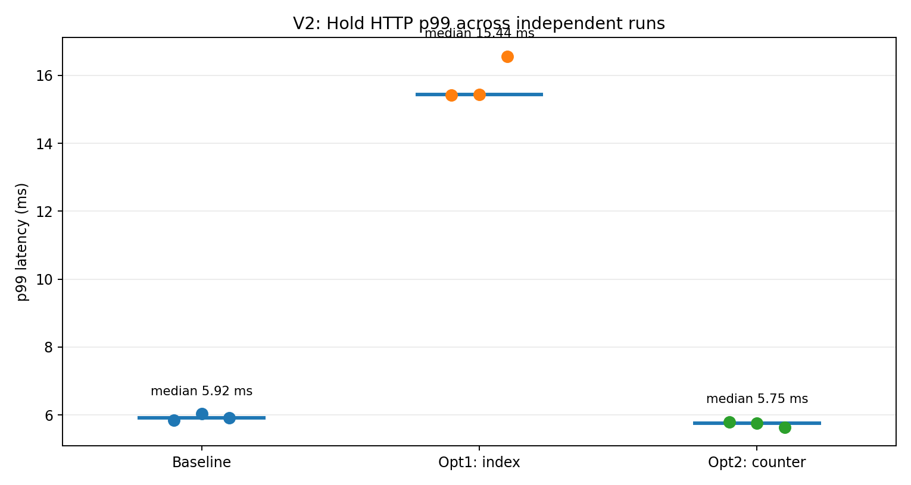
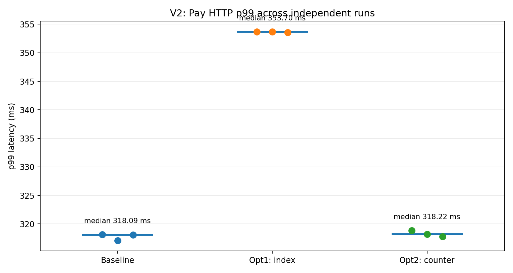

# HW1 — Soldout V2: динамическое ценообразование

**Трек:** А (собственная реализация). **Режим:** lite. **Вариация:** V2 — стадион с динамической ценой билета.  
**Основа кода:** tag `lesson-5` (`4a150509…`); ветка `hw1`; HEAD при сборе артефактов `3254f9efab5a106d3f8b060ff99cfa33ee055de3`.  
**Дата измерений:** 13 ноября 2026 г. **Инструменты:** Go 1.27.4, PostgreSQL 17, Docker 29.9.3, Docker Compose 5.7.0, k6, pg_stat_statements, Go pprof, OpenTelemetry/Tempo.

> **Краткий результат.** Реализована V2 с неизменяемой ценой hold, новыми миграциями, инвариантами I7–I8 и нагрузочным сценарием. Девять испытаний (3 варианта × 3 повторения) завершились без ошибок; все инварианты соблюдены. Частичный индекс заметно ускоряет SQL-подсчёт, но **ухудшает HTTP p99**. Транзакционный счётчик ускоряет SQL-операции расчёта цены и показывает небольшое снижение Hold p99 (~2,8%), однако преимущество для end-to-end невелико. **Два подтверждённых улучшения пользовательской задержки не получены; требование третьего уровня пока не доказано.**

## 1. Постановка, требования и расчёт нагрузки

- Спецификация: [`../../soldout/spec/soldout-v2.md`](../../soldout/spec/soldout-v2.md).
- Решение и CBAM-lite: [`../../soldout/docs/adr/ADR-101-v2.md`](../../soldout/docs/adr/ADR-101-v2.md).
- Актуальное задание: [HW_1.md в `main` курса](https://github.com/nikolaysavelev/system-design-hse-miem-2026-2027-public/blob/main/hw/hw1/HW_1.md). Текст `HW_1.md` в старом теге `lesson-5` отличается; ориентироваться следует на постановку из `main`.
- Правила вариации: [`variants.md`](variants.md), V2.

Функциональное правило: цена сектора зависит от **оплаченных**, а не удерживаемых мест. Для базовой цены `P₀=500000` минорных единиц, шага `N=100` и повышения `X=10%`:

```text
sold_count = число confirmed hold в (event_id, sector_id)
k = floor(sold_count / 100)
price_minor = round_half_up(500000 × (1 + 10/100)^k)
```

Ступени: 0–99 продаж → 500000; 100–199 → 550000; 200–299 → 605000; 300–399 → 665500 минорных единиц. Цена фиксируется **в момент hold**, сумма заказа равна сумме зафиксированных цен и не меняется при поздней оплате.

Планируемая интенсивность: `30 × 60 = 1800` покупок за минуту. Сценарий делает около семи HTTP-вызовов на покупку, что соответствует порядка 210 HTTP RPS (реально 209.0 RPS на испытаниях). Сектора распределены **40% / 20% / 20% / 20%**, т.е. ~720 / 360 / 360 / 360 мест из 4000 на одном мероприятии; все `seat_id` берутся из реальной seatmap и не повторяются. Тестируемое мероприятие: `10000000-0000-4000-8000-000000000002`; для каждого прогона используется независимая копия исходного дампа с нулём hold на этом мероприятии.

| SLO (спецификация) | Результат (медиана по 3 baseline-прогонам) | Выполнено |
|---|---:|---|
| Поток 30 итераций/с в течение 60 с | 1801 успешная оплата в каждом baseline-прогоне, 0 dropped | Да |
| `hold` p95 ≤ 200 мс | 4.57 мс | Да |
| `hold` p99 ≤ 400 мс | 5.92 мс | Да |
| `order` p99 ≤ 500 мс | 7.35 мс | Да |
| `pay` p99 ≤ 800 мс | 318.09 мс | Да |
| 5xx = 0; неожиданные HTTP-ошибки <1% | 0% в девяти прогонах | Да |
| Нарушения I1–I7, после оптимизации I8 = 0 | 0 в девяти прогонах | Да |

Важно: фактическое число завершённых итераций k6 иногда равно **1801** вместо 1800 из-за границы минутного окна constant-arrival-rate. Это не нарушает условия; сравнение использует реальное значение `iterations`, все варианты запускались с одной и той же заданной частотой. Нагрузка фиксирует **пропускную способность при заданном потоке**, но не определяет максимальный TPS системы.

## 2. Реализация и согласованность

| Узел | Изменение / доказательство |
|---|---|
| `catalog` | `sector_prices` с правилами `(event_id, sector_id, base_price_minor, step_seats, step_percent)`; `GetSectorPrice` через границу API модуля. |
| `booking` | `holds.sector_id`, `holds.price_minor`, `holds.sold_count_at_hold`; расчёт ступени перед вставкой hold, сумма заказа — сумма hold. |
| Синхронизация | `pg_advisory_xact_lock` на `(event, sector)` при чтении sold count на hold и подтверждении pay; порядок sector locks детерминирован. |
| `payment` / `ticketing` | Оплата по замороженной `orders.amount_minor` и выпуск билета; повторный pay идемпотентен. |
| Миграция `0022` | Создание правил сектора для существующих и будущих мероприятий, сохранение цен и миграция старых hold. |
| Миграция `0023` | Частичный индекс `holds_confirmed_sector_idx` (эксперимент №1). |
| Миграция `0024` | Таблица `booking_sector_sales`, начальная загрузка из confirmed holds (эксперимент №2). |
| Контракт | `soldout/api/openapi.yaml`: поля зафиксированной цены и количества проданных мест при hold. |
| Тесты | `internal/booking/domain/price_test.go` и `internal/booking/adapters/pg/pricing_integration_test.go`: граница 99→100, конкуренция, фиксированная цена, повторный pay, многоместный заказ. |
| Нагрузка | `soldout/k6/v2.js`: admission → hold → order → pay → tickets, проверки цен и успеха выпуска билета. |
| Очередь событий | В `compose/lesson-04.yml` задан `EVENTBUS_BUFFER` с default 40000 для обхода известного дефекта исходного `lesson-5`. |

**Инварианты.** Сохранены I1–I6 из исходного проекта. Добавлен I7: `orders.amount = SUM(holds.price_minor)` для каждой позиции заказа (учёт представления суммы в денежных единицах). С миграцией 0024 добавлен I8: `booking_sector_sales.sold_count` совпадает с `COUNT(holds WHERE status='confirmed')` по `(event_id, sector_id)`, включая отсутствующие и лишние строки. Прогон `make invariants` выполнен после асинхронного обновления проекции, все проверки имеют 0 нарушений. Выводы: [`artifacts/v2/base-invariants.txt`](artifacts/v2/base-invariants.txt), [`artifacts/v2/opt1-invariants.txt`](artifacts/v2/opt1-invariants.txt), [`artifacts/v2/opt2-invariants.txt`](artifacts/v2/opt2-invariants.txt).

**Проверки сборки.** `make lint-all`, `make test`, `go test -race ./... -count=1`, `git diff --check`: **PASS** (выводы и статус в [`artifacts/v2/STATUS.txt`](artifacts/v2/STATUS.txt) и [`artifacts/v2/repository.txt`](artifacts/v2/repository.txt)). Схемы экспериментальных баз: **22/23/24** для base/opt1/opt2.

## 3. Методика замеров

Три варианта исходного кода из независимых временных снимков:

1. `base`: подсчёт подтверждённых hold SQL `COUNT(*)`, схема 22.
2. `opt1`: `base` + частичный индекс по `(event_id, sector_id)` при `status='confirmed'`, схема 23.
3. `opt2`: `opt1` + транзакционный материальный счётчик продаж, схема 24. **Это последовательные изменения, не независимое факторное сравнение.**

Каждый вариант повторён три раза: отдельная `soldout_hw1_<variant>_r<run>` БД, восстановление из одного `/tmp/soldout-hw1-baseline.dump`, `ANALYZE`, перезапуск приложения, k6 `constant-arrival-rate=30/s` на 60 с; один и тот же event и распределение мест. Статистика `pg_stat_statements` сбрасывается по OID **конкретной тестовой БД**; основная `soldout` не восстанавливается и не удаляется. Сохранялись k6 JSON, топ SQL, EXPLAIN, pprof, запросы к Tempo и инварианты. Исходный инструмент: [`artifacts/v2/bench.sh`](artifacts/v2/bench.sh) и [`artifacts/v2/collect-evidence.sh`](artifacts/v2/collect-evidence.sh) (временные Compose overrides создаются в `/tmp`).

Ресурсные ограничения: режим `lite` с overlay `compose/lite.yml` и отдельным Compose override для тестовой БД. Фактические cgroup-лимиты не были отдельно экспортированы в архиве; вывод о строгом соответствии CPU/RAM лимитам из одного лога делать нельзя.

## 4. Результаты девяти независимых прогонов

| Вариант | № | Paid | HTTP RPS | Checks | HTTP errors | Dropped | Hold p50 | Hold p95 | Hold p99 | Order p99 | Pay p99 |
|---|---:|---:|---:|---:|---:|---:|---:|---:|---:|---:|---:|
| `base` | 1 | 1801 | 209.0 | 100% | 0.0% | 0 | 3.38 | 4.57 | 5.84 | 7.35 | 318.12 |
| `base` | 2 | 1801 | 209.0 | 100% | 0.0% | 0 | 3.42 | 4.67 | 6.03 | 7.39 | 317.09 |
| `base` | 3 | 1801 | 209.0 | 100% | 0.0% | 0 | 3.48 | 4.56 | 5.92 | 7.06 | 318.09 |
| `opt1` | 1 | 1801 | 208.9 | 100% | 0.0% | 0 | 3.40 | 5.92 | 15.42 | 14.29 | 353.70 |
| `opt1` | 2 | 1800 | 209.0 | 100% | 0.0% | 0 | 3.41 | 6.38 | 15.44 | 14.45 | 353.70 |
| `opt1` | 3 | 1800 | 209.0 | 100% | 0.0% | 0 | 3.55 | 6.29 | 16.56 | 14.63 | 353.59 |
| `opt2` | 1 | 1801 | 209.0 | 100% | 0.0% | 0 | 3.27 | 4.46 | 5.80 | 7.92 | 318.83 |
| `opt2` | 2 | 1801 | 209.0 | 100% | 0.0% | 0 | 3.24 | 4.28 | 5.75 | 7.38 | 318.22 |
| `opt2` | 3 | 1800 | 209.0 | 100% | 0.0% | 0 | 3.30 | 4.45 | 5.63 | 7.41 | 317.80 |

Все задержки указаны в **мс**. Доля 5xx равна 0 во всех прогонах. Машинные данные: [`artifacts/v2/run-metrics.csv`](artifacts/v2/run-metrics.csv); исходная таблица: [`artifacts/v2/RESULTS.md`](artifacts/v2/RESULTS.md).

### Медианы по трём прогонам (мс)

| Метрика | Baseline | Opt1 | Opt2 |
|---|---:|---:|---:|
| Hold p50 | 3.42 | 3.41 | 3.27 |
| Hold p95 | 4.57 | 6.29 | 4.45 |
| **Hold p99** | **5.92** | **15.44** | **5.75** |
| Order p99 | 7.35 | 14.45 | 7.41 |
| Pay p99 | 318.09 | 353.70 | 318.22 |





### Стоимость SQL, связанного с определением цены

| Вариант | Операция | Mean в прогонах №1 / №2 / №3, мс | Медиана mean, мс |
|---|---|---|---:|
| Base | `booking.count_sector_sales` | 0.1180 / 0.1215 / 0.1228 | 0.1215 |
| Opt1 | `booking.count_sector_sales` с индексом | 0.0466 / 0.0459 / 0.0478 | 0.0466 |
| Opt2 | `booking.get_sector_sales` | 0.0056 / 0.0056 / 0.0057 | 0.0056 |
| Opt2 | `booking.increment_sector_sales` (путь оплаты) | 0.0249 / 0.0235 / 0.0262 | 0.0249 |

В `opt2` уменьшение стоимости **чтения** счётчика компенсируется дополнительной записью в транзакции оплаты; поэтому некорректно сравнивать 0,0056 мс с 0,1215 мс как полную стоимость одной покупки. Сумма средних SQL-времён чтения и инкремента составляет примерно 0,0305 мс на покупку, не считая ожиданий блокировок и остальных операций. Топ запросов: [`artifacts/v2/base-pg-top.txt`](artifacts/v2/base-pg-top.txt), [`artifacts/v2/opt1-pg-top.txt`](artifacts/v2/opt1-pg-top.txt), [`artifacts/v2/opt2-pg-top.txt`](artifacts/v2/opt2-pg-top.txt).

### Топ-5 SQL по `total_exec_time` (репрезентативный прогон №2)

| Вариант | Запрос | Вызовов | Суммарно, мс |
|---|---|---:|---:|
| Base | `catalog.sector_counts` | 1802 | 291,80 |
| Base | `booking.count_sector_sales` | 1801 | 218,73 |
| Base | `booking.get_order` | 5403 | 211,35 |
| Base | `booking.insert_hold` | 1801 | 129,37 |
| Base | `catalog.sector_states` | 1801 | 128,84 |
| Opt1 | `catalog.sector_counts` | 1801 | 288,01 |
| Opt1 | `booking.get_order` | 5400 | 205,40 |
| Opt1 | `booking.lock_sector` | 3600 | 145,82 |
| Opt1 | `booking.insert_hold` | 1800 | 131,99 |
| Opt1 | `catalog.bump_sector_version` | 3600 | 128,12 |
| Opt2 | `catalog.sector_counts` | 1802 | 280,50 |
| Opt2 | `booking.get_order` | 5403 | 209,53 |
| Opt2 | `booking.insert_hold` | 1801 | 130,70 |
| Opt2 | `catalog.sector_states` | 1801 | 126,12 |
| Opt2 | `catalog.projection_upsert` | 3602 | 110,35 |

Скрипт эксперимента при сокращении SQL-текста заменял часть буквы `s` пробелами в колонке `query` (особенность `regexp_replace` в формировании отчёта); названия выше нормализованы по исходным SQL-комментариям, значения вызовов и времени не изменены. Полный вывод сохранён в `*-pg-top.txt`. Снижение `count_sector_sales` удалило его из топ-5, но основная доля SQL-времени всё ещё находится в чтениях каталога и заказов.

## 5. Эксперимент №1 — частичный индекс (миграция 0023)

**Гипотеза.** Рост количества оплаченных мест сделает `COUNT(*)` по `holds` всё дороже; индекс только по confirmed уменьшит число читаемых блоков. Точка изменения: `migrations/0023_confirmed_sector_index.up.sql`.

```sql
CREATE INDEX CONCURRENTLY IF NOT EXISTS holds_confirmed_sector_idx
    ON holds (event_id, sector_id) WHERE status = 'confirmed';
```

**SQL-доказательство.** `EXPLAIN (ANALYZE, BUFFERS)` для горячего сектора после прогона:

| Параметр | Baseline | Opt1 |
|---|---|---|
| План | Seq Scan по `holds` | Index Only Scan по `holds_confirmed_sector_idx` |
| Прочитано shared buffers | 62 hits | 30 hits |
| Строк по сектору | 721 | 721 |
| Heap Fetches | — | 529 |
| Execution Time | 0,280 мс | 0,169 мс |
| Mean `count_sector_sales` в прогоне №1 | 0,1180 мс | 0,0466 мс |

Оригиналы: [`artifacts/v2/base-explain-count.txt`](artifacts/v2/base-explain-count.txt), [`artifacts/v2/opt1-explain-count.txt`](artifacts/v2/opt1-explain-count.txt). Индекс действительно ускоряет **конкретный SQL** (~61,6% по медиане среднего времени на вызов).

**Влияние на пользовательскую задержку — отрицательное:** медиана Hold p99 возросла с 5.92 до 15.44 мс (**+160.9%**). Аналогично ухудшились Order и Pay p99. Нельзя утверждать, что ускорение SQL доказало оптимизацию HTTP. Даже при трёх похожих прогонах возможен внешний конфаундер (cache, нагрузка хоста); контролируемой причинной оценки нет. Для данного SLO индекс — **неподтверждённая/неудачная оптимизация**, требующая пересмотра, а не завершённый пункт третьего уровня.

## 6. Эксперимент №2 — транзакционный счётчик (миграция 0024)

**Гипотеза.** Цена должна зависеть только от числа продаж, поэтому хранение агрегата `booking_sector_sales` избавит `hold` от повторного подсчёта всех confirmed rows. Каждая первая успешная оплата увеличивает счётчик в транзакции изменения статуса hold и заказа; повторный pay не инкрементирует его.

**Результат SQL.** `booking.get_sector_sales`: медиана среднего времени ~0,0056 мс, `booking.increment_sector_sales`: ~0,0249 мс. Исходный COUNT: ~0,1215 мс. `EXPLAIN` для 8 строк счётчика показывает **Seq Scan** (1 shared buffer, Execution Time 0,060 мс в прогоне №1), а **не** Index Scan: для настолько маленькой таблицы оптимизатор предпочёл последовательное чтение. Первичный ключ есть; на большой таблице план может смениться. Оригинал: [`artifacts/v2/opt2-explain-counter.txt`](artifacts/v2/opt2-explain-counter.txt), [`artifacts/v2/opt2-pricing-sql.txt`](artifacts/v2/opt2-pricing-sql.txt).

**End-to-end.** Hold p99 по медиане: 5.92 → 5.75 мс (−2.8%). Order p99: 7.35 → 7.41 мс; Pay p99: 318.09 → 318.22 мс. Получено заметное улучшение SQL и **небольшое** улучшение Hold p99; нельзя делать вывод о большом приросте полного checkout.

**Корректность.** I8 проверяет эквивалентность счётчика confirmed holds после каждого прогона. Интеграционный тест дополнен повторной оплатой и многоместным заказом. Все I1–I8 зелёные. Особенность: `opt2` наследует индекс `opt1`, поэтому измерения не изолируют влияние одного счётчика от наличия индекса (последовательное сравнение `base → opt1 → opt2`).

## 7. CPU, трассировка и отказ от третьей оптимизации

**CPU.** Профили сняты во время нагрузки по 20 секунд, а не после неё. Порядка 2,7–3,0 CPU-секунд сэмплов за 20 с в каждой версии. Главные flat-функции — `internal/runtime/syscall/linux.Syscall6` (~24–28% CPU в примерах), `runtime.futex`, операции GC и JSON. Это **не доказывает**, что `COUNT(*)` — главный bottleneck всего HTTP-пути; на 30 покупок/с ограничение 400 мс по Hold p99 далеко не исчерпано. Примеры: [`artifacts/v2/base-pprof-top.txt`](artifacts/v2/base-pprof-top.txt), [`artifacts/v2/opt1-pprof-top.txt`](artifacts/v2/opt1-pprof-top.txt), [`artifacts/v2/opt2-pprof-top.txt`](artifacts/v2/opt2-pprof-top.txt).

**Tempo.** Во время некоторых прогонов `make traces-slow` вернул 20 совпадений, в других — 0 из-за ограниченного окна поиска/сэмплирования. Выдача Tempo содержала длительности корневых трейсов **3–5 с**, несопоставимые с максимальным временем `pay` по k6 (~0,3–0,4 с). Без выгрузки полного trace JSON и проверки корневого и дочерних spans нельзя использовать эти числа как доказательство задержки `pay`. Примеры поиска: [`artifacts/v2/base-traces-slow.txt`](artifacts/v2/base-traces-slow.txt), [`artifacts/v2/opt1-traces-slow.txt`](artifacts/v2/opt1-traces-slow.txt), [`artifacts/v2/opt2-traces-slow.txt`](artifacts/v2/opt2-traces-slow.txt). **Полный разбор одного корректно сопоставленного трейса не приложен.**

**Что сознательно не оптимизировал.** Удаление sector advisory lock могло бы сократить время ожидания, но нарушает сериализацию hold/pay на переходах ступени. Без альтернативной модели согласованности это неприемлемо. Не отключались проверки статуса заказа, лимита билетов и сохранение событий через outbox. Не переносился синхронный выпуск билета на асинхронный путь: это выходит за scope HW1/ограничения исходной версии.

## 8. Как использовался ИИ

**Инструмент:** ChatGPT (OpenAI). Использовался для поиска и сверки материалов, обсуждения архитектурных решений, подготовки черновиков спецификации и ADR, предложений по Go/SQL/k6 и оформления отчёта. Вручную выбирались требования и метрики, применялись изменения, запускались тесты и анализировались результаты Docker, k6, PostgreSQL и профилирования.

**Ошибки и проверка:** первоначальный k6 выбирал некорректные места (HTTP 422), использовал неверное мероприятие по умолчанию, а фоновый Compose останавливался из-за stdin. Проблемы выявлены по логам и исправлены перед повторными прогонами. Частичный индекс ускорил SQL, но ухудшил HTTP p99; это установлено тремя повторными измерениями и отражено в выводах.

## 9. Известные ограничения, открытые критерии и следующие действия

- **Критерий двух оптимизаций третьего уровня пока не закрыт:** `opt1` ухудшил HTTP p99, `opt2` улучшил его незначительно. Для честного достижения максимального уровня требуется найти второе **реально улучшающее end-to-end** изменение, снять до/после при одинаковой нагрузке и обновить эту таблицу.
- **Контрольный `make storm` после изменений не представлен** в загруженном архиве. В актуальном шаблоне отчёта HW1 требуется показать, что исходный путь `hold` не деградировал; этот прогон нужно сделать отдельно в безопасном экспериментальном окружении.
- **Трейс:** есть результаты поиска Tempo, но нет выгруженного полного trace JSON со span-диаграммой. Для полноценной интерпретации и сопоставления с k6 нужна выгрузка одного конкретного трейса.
- **Проверка лимитов CPU/RAM:** требуется сохранить `docker inspect`/Compose effective resource limits на момент тестирования, если это будет проверяться отдельно.
- **Изолированность:** сравнение последовательных `base → opt1 → opt2` не отделяет контрфактический эффект `opt2` без индекса. Дополнительный вариант `base + counter` и чередование порядка испытаний усилили бы дизайн эксперимента.
- **SLO:** `pay` включает эмульсированный внешний вызов PSP ~300 мс, поэтому не равен времени SQL-транзакции. Максимальную пропускную способность из фиксированной частоты 30/s выводить нельзя.

**Статус на 13.11.2026:** функциональная часть, корректость, измерения девяти прогонов и документирование экспериментов готовы; необходима дополнительная оптимизация и контрольные артефакты для уверенного соответствия третьему уровню. Итоговая оценка определяется преподавателем по актуальному условию задания.
